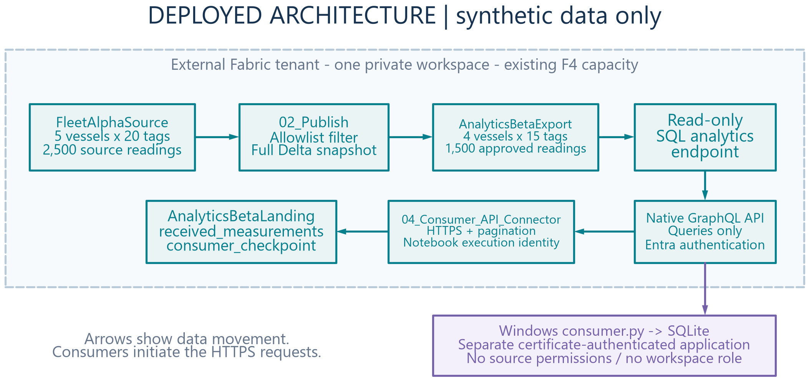
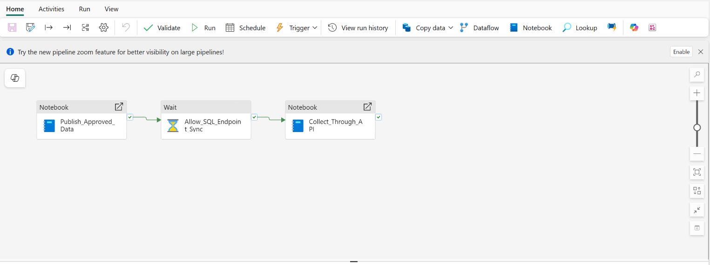
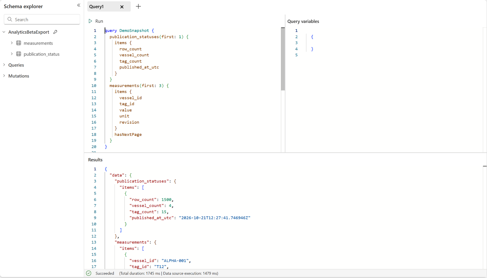
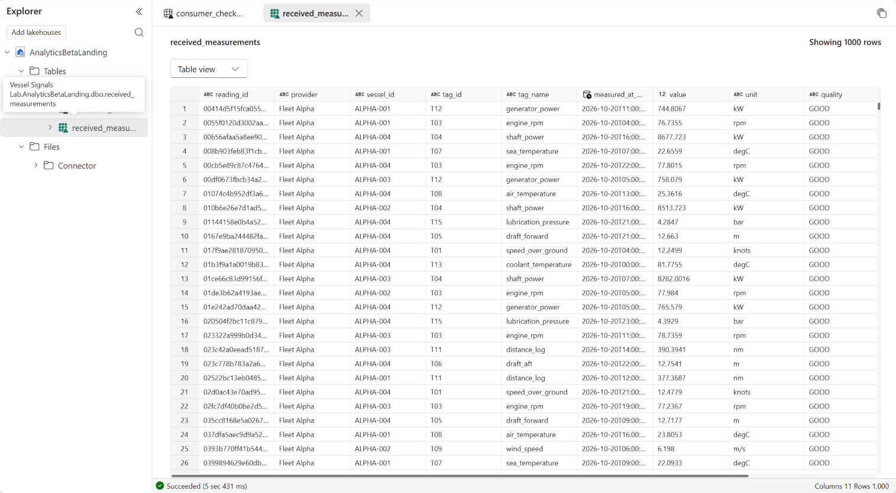

Vessel Signals Lab
==================

**Share the measurements a partner needs, not the system that produced them.**

A synthetic, end-to-end Microsoft Fabric lab showing how a vessel-data provider
can publish an approved telemetry dataset through a read-only GraphQL API, and
how a consumer can retrieve new and corrected readings without duplicating them.

Fleet Alpha and Analytics Beta are fictitious. Every vessel, tag and measurement
is synthetic. This is a learning and demonstration project, not a production
maritime system or an officially supported Microsoft product.

Why this exists
---------------

A data-sharing conversation often starts with "give the partner access to our
database." That couples the partner to the source system, exposes more than the
intended contract, and leaves difficult questions about access, freshness,
corrections and retries.

This lab makes those questions concrete:

* **What may leave the source?** Only four approved vessels and fifteen approved
  measurement tags, materialized in a separate export Lakehouse.
* **How does a consumer integrate?** Through authenticated HTTPS and GraphQL
  pagination, rather than direct reads of the provider's source Lakehouse.
* **What happens when an old reading changes?** The same stable ``reading_id``
  is updated using its modification timestamp and revision.
* **What happens after a failed download?** The standalone SQLite connector
  commits its data and checkpoint together, so a failed run can be replayed.
* **What has actually been built?** The screenshots show a recorded synthetic
  deployment. Proposed production extensions are labelled separately.

The important boundary is the **published dataset**, not a filter chosen by the
caller. Client-side scope checks are additional protection, not authorization.

Architecture
------------

The diagram records the reference demo after one change simulation: 2,500 source
readings and 1,500 approved readings. A fresh deployment starts at 2,400 and
1,440 respectively. Its F4 annotation describes that reference deployment, not
an instruction to provision an F4 capacity.

The main Fabric path is:

.. code-block:: text

   Synthetic telemetry
       -> FleetAlphaSource
       -> approved publication
       -> AnalyticsBetaExport / SQL analytics endpoint
       -> read-only Fabric GraphQL API
       -> HTTP consumer notebook
       -> AnalyticsBetaLanding

An optional Windows connector uses a separately provisioned certificate-backed
Entra application and persists into SQLite. The Fabric notebook instead uses its
execution identity; running it does not prove that a separate partner identity
has been isolated.

See `the architecture and trust boundaries <docs/architecture.rst>`_.

What the demo proves
-------------------

.. list-table::
   :header-rows: 1
   :widths: 28 36 36

   * - Scenario
     - Expected result
     - Why it matters
   * - Initial publication
     - 2,400 source rows; 1,440 approved rows
     - Source scope and sharing scope are different.
   * - Excluded scope
     - No ALPHA-005 or tags T16-T20 in the export
     - Partners receive an explicit published contract.
   * - One intentional change simulation
     - 100 new source rows; 60 new approved rows; one correction
     - New data and corrections need separate semantics.
   * - Repeat consumer run without changes
     - No duplicate readings
     - Retries should be safe.
   * - Local persistence failure
     - SQLite checkpoint does not advance
     - Progress must follow durable persistence.

Screenshots from the working reference demo
------------------------------------------

**Recorded reference: publish -> wait -> collect through the API**

**Approved data returned by the GraphQL API**

**The consumer landing table**

These are cropped screenshots captured on 21 October 2026, not output promised
from your deployment. Account headers, email addresses and resource/run
identifiers are excluded. The visible 1,500-row publication follows one change
simulation; the landing preview's 1,000-row limit is not a total-row count.
The portable version improves on the recorded pipeline: it has two activities,
passes the publisher's exact result to the consumer, and polls publication
freshness instead of treating a fixed wait as sufficient.

See `all six screenshots and their context <docs/screenshots.rst>`_.

Deploy it
---------

Start with the `deployment guide <docs/deployment.rst>`_. It explains the
prerequisites, configuration, guarded deployment commands and the GraphQL
checkpoint. Use an existing active Fabric capacity; this repository must not
create or resume paid capacity on your behalf.

.. code-block:: powershell

   Copy-Item .\lab-config.example.json .\lab-config.json
   # Edit lab-config.json with your tenant, existing active capacity and a NEW workspace name.
   az login --tenant YOUR-TENANT-GUID --allow-no-subscriptions
   python fabric_lab.py
   python fabric_lab.py preflight
   python fabric_lab.py prepare --apply

Complete the guided GraphQL checkpoint printed by ``prepare``, then:

.. code-block:: powershell

   python fabric_lab.py attach --endpoint "COPIED-ENDPOINT" --confirm-read-only --apply
   python fabric_lab.py complete --apply

``python fabric_lab.py`` is an offline plan. Cloud-writing commands require
``--apply``. GraphQL table selection and read-only configuration are an
explicit Fabric UI checkpoint, not a claimed one-click automation.

For an AI coding agent, use the `agent deployment instructions
<AGENTS.md>`_. They specify what to ask, what can run without writes,
where human confirmation is required, and what a successful deployment means.

Copy this request into your coding agent:

.. code-block:: text

   Deploy Vessel Signals Lab for me. Read the repository's agent deployment
   instructions and docs/deployment.rst. Ask only for missing tenant,
   existing capacity and workspace decisions. Show me the read-only plan
   before any cloud writes. Use the guided GraphQL checkpoint where needed,
   resume safely, and report actual end-to-end results and running costs.
   Do not create capacity, grant broad consumer permissions or add schedules.

**Do not copy a reference deployment's tenant, workspace, endpoint or identity.**
Supply your own configuration. Generated local state and credentials do not
belong in Git.

Scope and honest limitations
---------------------------

* The source is simulated. No live vessel, production SQL database or gateway
  is connected.
* Publication is a small full Delta snapshot, not a production CDC pipeline.
* The consumers support inserts and corrections, not a hard-delete feed.
* SQL analytics visibility is asynchronous. The portable consumer polls the
  exact publication marker for up to ten minutes; this is not an atomic
  multi-table snapshot or an unlimited freshness guarantee. Avoid overlapping
  publish/collect runs.
* The SQLite connector has a single local transaction. Fabric Delta merges and
  checkpoint writes are separate operations; replay safety is not a claim of
  a cross-table transaction.
* API Management, cross-tenant onboarding, production scheduling, key rotation,
  monitoring and recovery policies require additional design.
* The reference demo places source, export and landing in one workspace.
  Production isolation may require separate workspaces and explicit identity
  and data-access design.
* An active capacity incurs costs. Pausing capacity can make the API
  unavailable. This project does not manage your capacity lifecycle.
* Publisher-result retrieval can require Fabric's Notebook job-instance query
  API with ``beta=true`` when the core scheduler response lacks the exit value.
  This preview dependency can be affected by service or tenant changes.

See `the production extension diagram <assets/diagrams/03-production-extension.png>`_.

Documentation
-------------

* `Architecture and trust boundaries <docs/architecture.rst>`_
* `Deployment and troubleshooting <docs/deployment.rst>`_
* `Agent deployment instructions <AGENTS.md>`_
* `Screenshot gallery <docs/screenshots.rst>`_

The diagrams are included as PNG previews, editable SVGs and structured JSON
specifications under ``assets/diagrams``. There are no live deployment
identifiers, original Office guides, databases, run evidence or dependency
caches in this public package.

License
-------

The sample code and original documentation are provided under the
`MIT License <LICENSE>`_. Microsoft product names, logos and UI elements in
screenshots remain subject to their owners' rights; no trademark rights or
official endorsement are granted.
