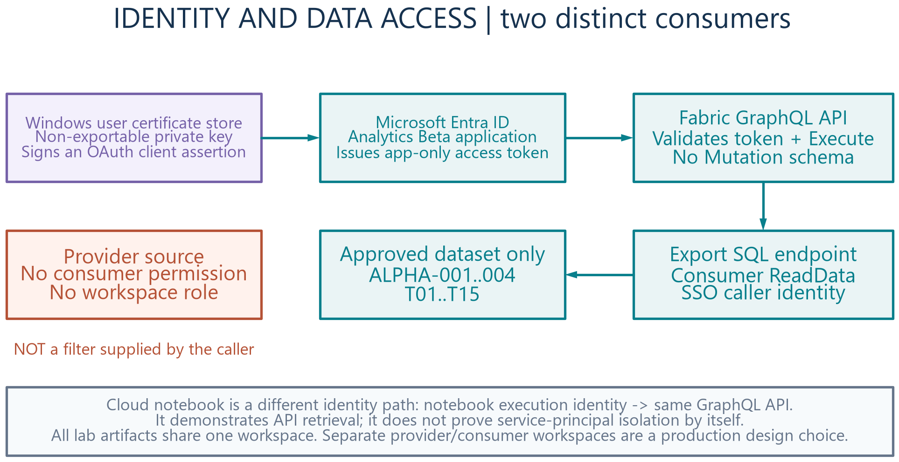
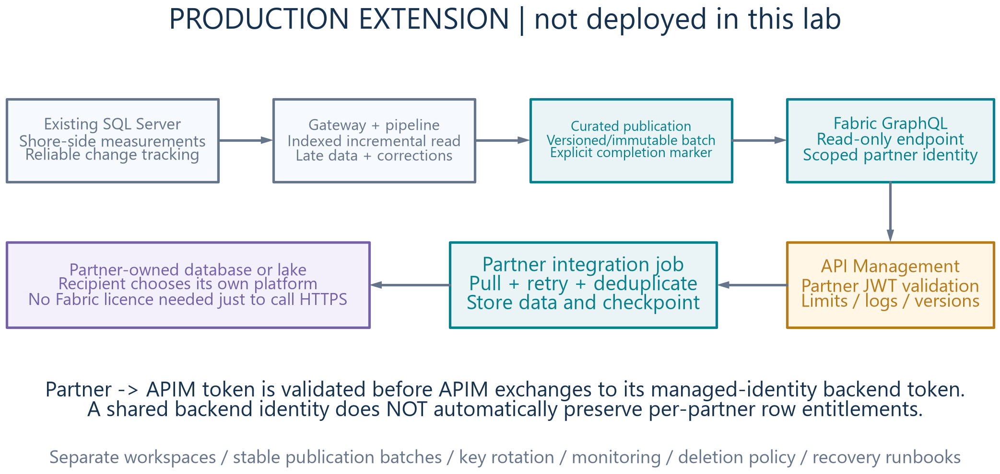

Architecture and trust boundaries
=================================

The problem
-----------

A provider owns a richer telemetry dataset than a consumer is allowed to see.
The integration must make that boundary explicit, give consumers a stable
contract, and distinguish late corrections from genuinely new measurements.

This lab uses fictitious Fleet Alpha as the provider and Analytics Beta as the
consumer. It deliberately separates publication, API retrieval and persistence
so each step can be explained and inspected.

Reference topology
------------------

.. image:: ../assets/diagrams/01-deployed-architecture.png
   :alt: The deployed reference topology.

``FleetAlphaSource``
   Schema-enabled Lakehouse holding five invented vessels, twenty tags and
   twenty-four hourly observations per vessel/tag pair: 2,400 initial readings.

``02_Publish_Approved_Data``
   Reads the synthetic source and materializes only ALPHA-001 through ALPHA-004
   and T01 through T15. The fifth vessel and the remaining five tags are
   excluded before any consumer query.

``AnalyticsBetaExport``
   Holds ``dbo.measurements`` and ``dbo.publication_status``. Its initial
   approved dataset has 1,440 readings. The SQL analytics endpoint exposes
   these Delta tables to the GraphQL API after asynchronous synchronization.

``AnalyticsBetaTelemetryAPI``
   Native Fabric GraphQL, exposing only the approved export tables. The
   intended contract has queries, no mutations, and authenticated access.
   Disabling mutation operations is an explicit deployment requirement.

``04_Consumer_API_Connector``
   Calls the API over HTTPS, follows pagination, checks approved scope, merges
   by stable reading ID, and writes the consumer checkpoint after persistence.
   It is not a shortcut or a direct copy from the source Lakehouse.

``AnalyticsBetaLanding``
   Holds ``dbo.received_measurements`` and ``dbo.consumer_checkpoint``.

``Publish_And_Collect``
   The recorded reference pipeline publishes, waits and collects. The portable
   version has two activities: publish, then collect. It passes the publisher's
   exact exit marker into the consumer, which polls publication-status reads
   for up to 600 seconds before continuing. This is not a service-level or
   cross-table consistency guarantee.

The reference screenshots also contain a ``00_Start_Here`` notebook and a
downloadable connector bundle. The portable deployment instead supplies its
runbook and standalone connector directly in this repository; it deploys four
executable notebooks and does not bundle an operator's identity into OneLake.

Identity is a separate design dimension
--------------------------------------

The cloud notebook uses its **notebook execution identity**. In the reference
workspace that identity can be more privileged than the consumer being
simulated. A successful notebook run proves the HTTP retrieval path, not
least-privilege external access.

The optional standalone Windows connector uses a **separate Entra
application**, with its private key held in the current user's certificate
store. Its intended permissions are API Read/Execute and the required SQL
read access to the isolated export, without a workspace role, source access or
provider write access. This identity must be provisioned and assessed
separately; do not grant Contributor merely to get a demo working.

The API must not be anonymous. A dedicated export is also not a substitute for
checking identities, tenant settings and actual access grants.

Reading and change contract
---------------------------

Each reading includes:

* ``reading_id``: deterministic identifier of vessel, tag and observation time.
* ``measured_at_utc``: when the observation was made.
* ``modified_at_utc``: when its published value was changed.
* ``revision``: the reading's revision number.
* ``vessel_id``, ``tag_id``, ``value``, ``unit`` and ``quality``.

Consumers bound downloads with the published upper modification watermark.
Subsequent requests use modification time rather than observation time, so a
correction to an older observation can still be retrieved. Pages have a stable
reading-ID order; repeated or missing continuation cursors are errors.

The standalone connector persists rows and progress in one SQLite transaction.
The Fabric connector merges Delta data and then writes a separate checkpoint.
If a Fabric run fails between those writes, rerunning must replay the same
range safely; it is not a distributed transaction.

Demonstration sequence
----------------------

1. Seed once: 2,400 source readings.
2. Publish: 1,440 approved readings.
3. Collect: 1,440 distinct readings in a fresh consumer.
4. Intentionally simulate another hour: 100 source additions, including
   60 approved additions, plus one correction to an existing approved reading.
5. Publish and collect: 1,500 distinct approved readings; the correction keeps
   its original ID.
6. Collect again without source changes: no duplicate records.

The simulation is intentionally mutating and is not an idempotent setup step.
Every further simulation adds another hour. Do not run it as a health check.

Consistency limits
------------------

This small lab overwrites a publication snapshot and then writes its status.
The SQL endpoint can observe them at different times. Pagination does not
provide a transactionally pinned snapshot across a concurrent publication.
Row-count checks catch some inconsistencies, not every same-count correction
race.

For the demo, serialize publishing and collection. For production, design
immutable/versioned batches and an explicit completion contract, or an
equivalently strong consistency model. Add a deletion feed or tombstones if
consumers must remove data.

Beyond the lab
--------------

Possible extensions include reliable source change tracking, gateway-based
ingestion, separate provider and consumer workspaces, immutable publication
batches, partner onboarding, monitoring and a documented recovery policy.

API Management is optional and is not deployed here. A shared APIM backend
identity does not automatically preserve per-partner row entitlements:
authorization must still be designed end to end.

An HTTPS client does not need a Fabric workspace merely to store its results
elsewhere, but API permissions, tenant policy, licensing terms and available
provider capacity still apply.
