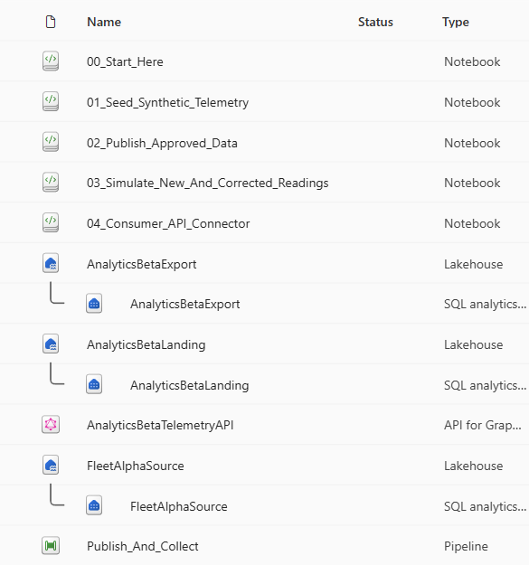
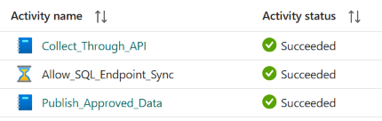
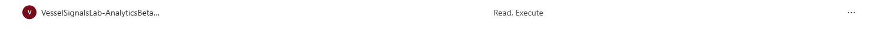

Screenshot gallery
==================

These images were captured from a working synthetic reference lab on
21 October 2026. They are evidence of that recorded demonstration, not a live
status feed or proof that a new checkout has been deployed.

The public copies are cropped to remove account headers, the administrator's
email address, owner details and resource/run identifiers. Cropping does not
change the visible query results or activity outcomes. All visible vessel and
organization names are fictitious.

Project inventory
-----------------

The reference project contains five notebooks, three Lakehouses with their SQL
analytics endpoints, a GraphQL API and a pipeline. SQL analytics endpoints are
related items, not additional independently provisioned source systems.

Pipeline design
---------------

.. image:: ../assets/screenshots/02-pipeline-canvas.png
   :alt: Publish, wait and collect activities connected in sequence.

The pipeline publishes approved data, waits briefly for SQL analytics
synchronization and then runs the API consumer. There is no recurring schedule.
The wait is a demo convenience, not a guarantee that every table is current.
The portable deployment in this repository replaces that wait activity with
bounded publication-marker polling inside the consumer and therefore has
two pipeline activities, not three.

Recorded successful run
-----------------------

The three activities succeeded in the recorded reference run. The crop excludes
the original run ID and the operator's details.

GraphQL query and results
------------------------

.. image:: ../assets/screenshots/04-api-query-results.png
   :alt: Publication metadata and a page of approved synthetic measurements.

The query returns publication metadata and measurements. The 1,500-row
publication follows one intentional change simulation; a fresh deployment
initially publishes 1,440 rows.

Dedicated application access
----------------------------

This crop shows only the dedicated consumer application's API permission row.
The administrator's separate row is excluded. The image demonstrates the API
grant, not every permission elsewhere in the tenant. The notebook-based easy
deployment does not automatically establish or prove this app-only boundary.

Persisted consumer measurements
------------------------------

.. image:: ../assets/screenshots/06-landing-measurements.png
   :alt: Approved synthetic vessel readings in the consumer landing table.

The Lakehouse preview shows ``received_measurements``. The UI preview is capped
at 1,000 rows; that is not the total size of the stored dataset. A deployment
must inspect actual counts and scope rather than infer them from a screenshot.
